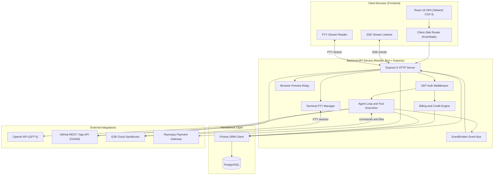
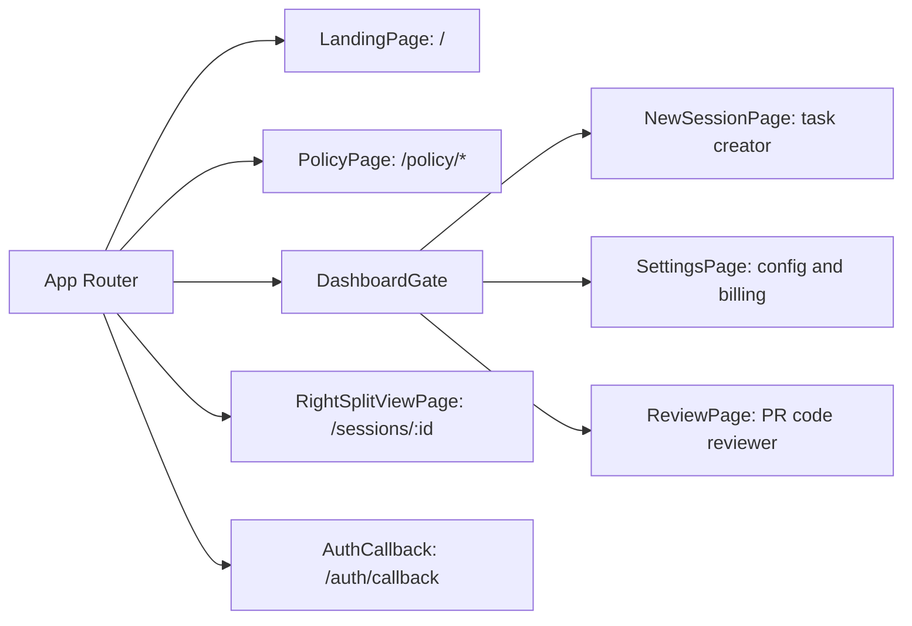
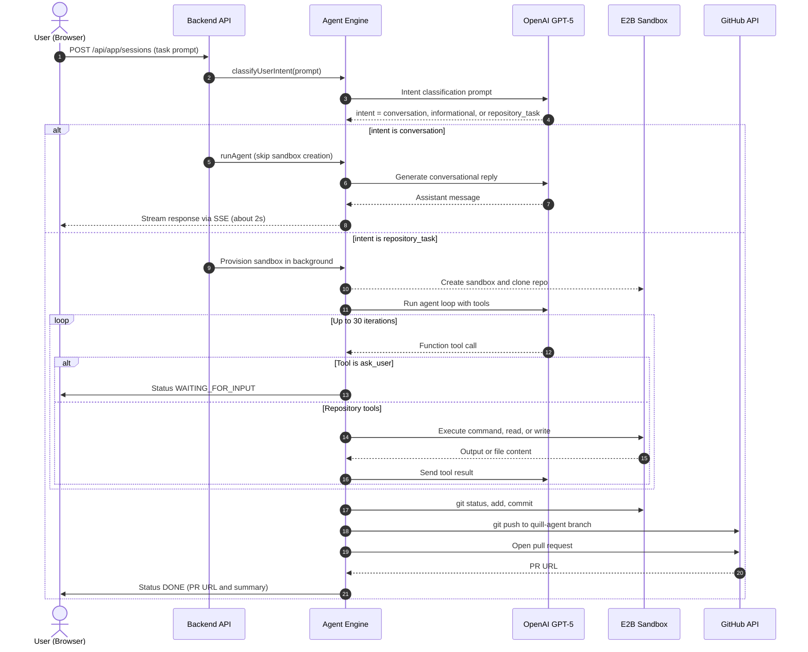
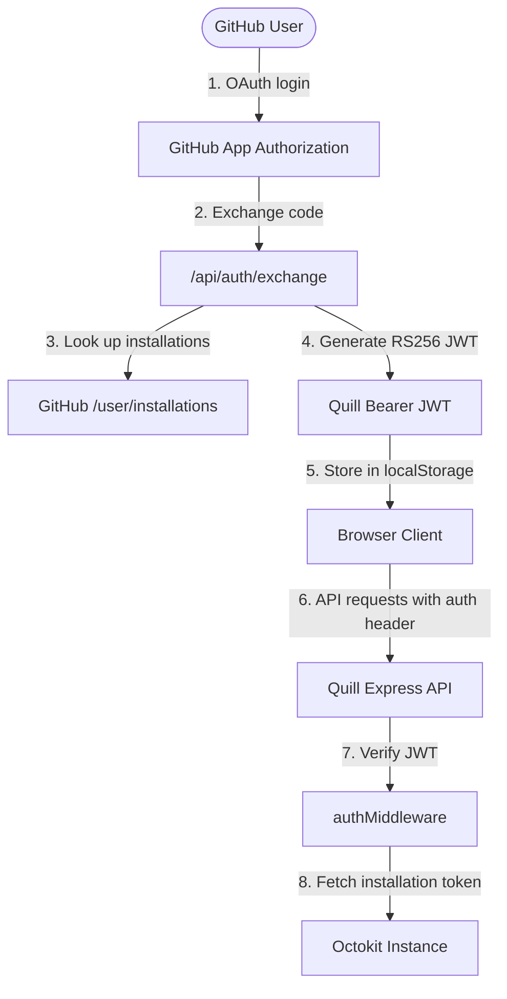
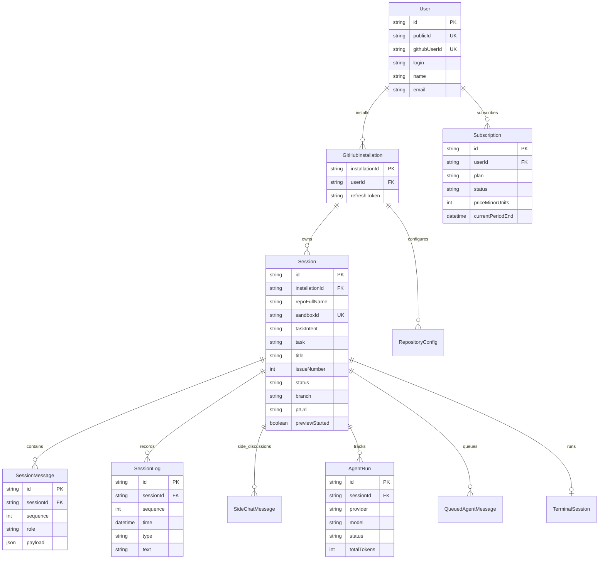
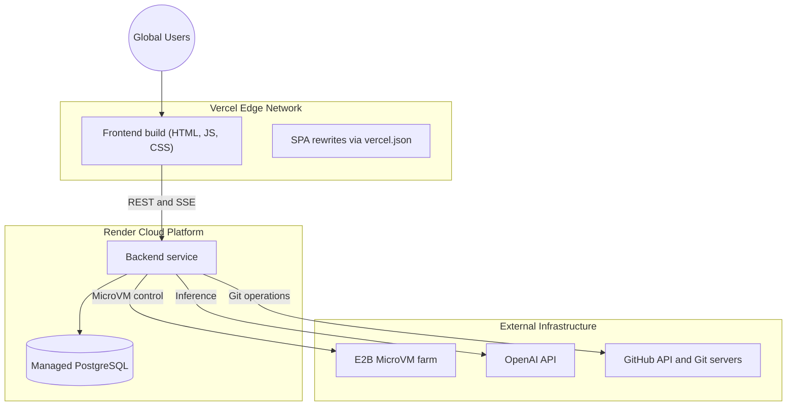

# Quill System Architecture & Technical Design

## 1. Overview

**Quill** is an Cloud AI Agent and a software engineering copilot. Developers connect their GitHub repositories, assign natural-language coding tasks, ask technical questions, and receive automated pull requests with tested code changes.

Quill integrates directly with:

1. **GitHub App & OAuth APIs**: granular repository permissions, branch management, and PR creation.
2. **E2B MicroVM sandboxes**: isolated, ephemeral Linux environments where code is cloned, modified, built, tested, and run, with terminal and browser preview support.
3. **OpenAI GPT-5 agent engine**: autonomous tool-use loop with intent classification, multi-turn reasoning, and secret redaction.
4. **Real-time streaming (SSE and PTY)**: agent logs, chat messages, status transitions, and interactive terminal sessions.
5. **Subscription and credit metering**: Razorpay-backed plans with follow-up credit consumption.

---

## 2. High-Level System Topology



---

## 3. Frontend Architecture (`fe/`)

A lightweight single-page application built on React 19, bundled with Bun, and styled with Tailwind CSS 4.

### 3.1 Technology Stack

| Area | Choice |
|---|---|
| Framework | React 19 |
| Bundler | Bun (`bun build`) |
| Styling | Tailwind CSS 4 plus custom dark/light themes |
| Icons | `lucide-react` |
| Markdown | `react-markdown` + `remark-gfm` |
| Deployment | Vercel SPA (`fe/vercel.json` rewrites) |

### 3.2 Page and Route Hierarchy



- [`App.tsx`](../fe/src/App.tsx): dispatches views using a custom `pushState` router in [`router.ts`](../fe/src/lib/router.ts).
- **`DashboardGate`**: guards authenticated routes by checking the JWT and GitHub App installation status.
- **`RightSplitViewPage`** ([`RightSplitView.tsx`](../fe/src/pages/RightSplitView.tsx)): the core interface. A left conversational timeline with markdown rendering, and a right workspace drawer with:
  - **Files**: workspace file explorer and inline editor.
  - **Changes**: live `git diff` against workspace `HEAD`.
  - **Terminal**: interactive Ubuntu bash shell over an E2B PTY stream.
  - **Side Chat**: out-of-band assistant chat that does not modify main conversation state or run repository tools.
  - **Progress**: real-time status and structured activity logs.

### 3.3 Real-Time Streaming Channels

1. **Agent activity stream** (`/api/session/:id/stream`): Server-Sent Events carrying `log`, `message`, and `status` updates, with automatic reconnect logic in [`api.ts`](../fe/src/lib/api.ts).
2. **Terminal stream** (`/api/app/sessions/:id/terminal/stream`): base64-encoded chunked stream supporting keystroke delivery, screen redraws, and terminal resize (`SIGWINCH`).

---

## 4. Backend Architecture (`be/`)

Built with Bun and Express 5, using an asynchronous, event-driven pattern for long-running AI tasks.

| Module | Location | Responsibility |
|---|---|---|
| Entry point and API gateway | [`index.ts`](../be/index.ts) | Express config, CORS, route dispatch, auth exchange, webhooks, SSE endpoints. |
| Agent engine | [`agent.ts`](../be/agent.ts) | Intent classifier, tool loop, OpenAI orchestration, git publisher, secret scanner. |
| Session lifecycle | [`sessions.ts`](../be/sessions.ts) | DB sync, status updates, message appends, log truncation, token redaction. |
| Session routes | [`routes/session.ts`](../be/routes/session.ts) | Preview detection (`detectPreviewSetup`), workspace bootstrap, session deletion. |
| GitHub App integration | [`lib.ts`](../be/lib.ts) | Octokit auth, RSA JWT signing, installation token exchange. |
| Billing and credits | [`billing.ts`](../be/billing.ts) | Credit allocation, subscription checks, plan enforcement. |
| Terminal sessions | [`terminal-sessions.ts`](../be/terminal-sessions.ts) | Tracks PTY process IDs per session in PostgreSQL. |
| Event pub/sub | [`events.ts`](../be/events.ts) | Node `EventEmitter` coordinating multi-subscriber SSE broadcast. |
| Relay stream | [`browser-stream.ts`](../be/browser-stream.ts) | Injects a headless browser relay script into E2B to proxy web dev servers. |

---

## 5. Autonomous Agent System

The agent uses a classified hybrid loop: a fast path for casual chat, and a sandboxed tool-augmented loop for repository changes.



### 5.1 Intent Classification

Every incoming message goes through `classifyUserIntent()` in [`agent.ts`](../be/agent.ts):

- **`conversation`**: greetings and casual chat. The sandbox is bypassed entirely, giving replies in about 2s.
- **`informational`**: general questions that may need codebase inspection. Tools are available; the sandbox is provisioned lazily only if the model calls `read_file`.
- **`repository_task`**: requests to inspect, edit, fix, test, or build code. The E2B sandbox is provisioned speculatively in the background while the model plans.

### 5.2 Tool Registry

| Tool | Behavior |
|---|---|
| `run_command(command)` | Runs a shell command in `/home/user/repo` with a 120s timeout. |
| `read_file(path)` | Reads files up to 20,000 characters, relative to repo root. |
| `write_file(path, content)` | Writes or overwrites workspace files. |
| `ask_user(question)` | Halts the turn, sets status `waiting_for_input`, awaits user reply. |

### 5.3 Git Publishing and Secret Scanning

Before pushing:

- `findExposedSecrets(diff)` scans for private keys, GitHub tokens, AWS keys, Slack tokens, JWTs, Stripe keys, and live Razorpay credentials.
- `publishChanges()` checks for uncommitted changes, creates a dedicated branch (`quill-agent-<task>-<timestamp>`), commits as `cloud-agent`, pushes with installation credentials, and opens a PR with a structured task summary.
- Remote URLs are scrubbed after publishing so installation tokens never remain in `.git/config`.

---

## 6. E2B Sandbox Runtime

E2B provides hardware-virtualized MicroVMs running Ubuntu Linux.

### 6.1 Workspace and Lifecycle

- Path: `/home/user/repo`
- Isolation: each session has a unique `sandboxId`.
- Idle timeout: 30-minute sliding window (`sandbox.setTimeout(30 * 60 * 1000)`).
- Configured with `onTimeout: "pause"` and `autoResume: true`.
- Lazy reconnection: `ensureSessionSandbox()` in [`lib.ts`](../be/lib.ts) detects expired sandboxes (`SandboxNotFoundError`) and provisions a clean replacement.

### 6.2 Automatic App Preview Detection

`detectPreviewSetup()` in [`routes/session.ts`](../be/routes/session.ts) analyzes the workspace:

- Detects the package manager (`bun`, `pnpm`, `yarn`, `npm`) from lockfiles.
- Reads `package.json` or `go.mod` to resolve dev and start scripts.
- Detects frameworks (`next`, `vite`) and injects host/port config (`0.0.0.0:3000`).
- Spawns background servers and verifies readiness via `curl` polling (`waitForPort`).

---

## 7. Security, Auth and Multi-Tenancy



1. **Authentication**: users sign in via GitHub OAuth.
2. **Authorization**: the backend signs an RS256 JWT containing `userId`, `login`, and `installationId`.
3. **Repository boundaries**: Octokit instances use short-lived GitHub App installation tokens scoped to the tenant's `installationId`. Quill can only access repositories the user granted in GitHub App settings.

---

## 8. Database Architecture (PostgreSQL and Prisma)

The schema ([`schema.prisma`](../be/prisma/schema.prisma)) models users, GitHub installations, sessions, logs, agent runs, and subscriptions.



---

## 9. Monetization and Credits (`billing.ts`)

### 9.1 Plan Tiers

| Plan | Credits |
|---|---|
| Free | 5 (lifetime trial) |
| Basic | 50 per billing period |
| Pro | 100 per billing period |

### 9.2 Credit Consumption

- Creating a session consumes **1 credit**.
- Every **2 follow-up requests** in the same session consume **1 additional credit**.

```text
credits = 1 + floor(max(0, requestCount - 1) / 2)
```

| Requests in session | Credits used |
|---|---|
| 1 | 1 |
| 2 | 1 |
| 3 | 2 |
| 5 | 3 |

Razorpay handles checkout orders (`/create-order`) and signature verification (`/verify-payment`), with automatic subscription activation.

---

## 10. Production Deployment



- **Frontend**: Vercel (`quill-si.vercel.app`). All paths rewrite to `dist/index.html` for client-side routing.
- **Backend**: Render (`quill-c05l.onrender.com`), running Bun in Linux containers.
- **Database**: managed PostgreSQL on Render, schema managed via Prisma.
- **Local development**: runnable via Bun, frontend on `localhost:3000` and backend on `localhost:3001`.